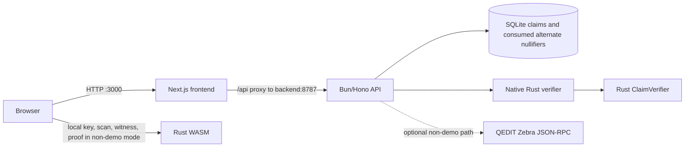

# Architecture

Horoi has the five MVP Next.js routes plus the authorized ZECATHON `/demo` walkthrough, a Bun/Hono API with SQLite, one canonical Rust claim library shared with browser WASM and the native verifier, and an optional QEDIT Zebra RPC connection for non-demo operation.

## Docker execution modes and trust boundaries

The default root `docker-compose.yml` is **DOCKER JUDGE DEMO**. Browser traffic reaches the Next.js production container on port 3000; Next.js proxies `/api` to `http://backend:8787` over an internal Compose network. The backend runs the native `horoi-verifier` and writes replay state to a project-scoped persistent SQLite volume. Only the frontend port is published to the host. This mode has no `.env`, RPC credentials, public-chain access, or snapshot scan at startup.

Judge and public Docker modes both load the exact pinned HCP1 fixture and the same Rust verifier. At startup Rust derives the claim ID/domain and verifies the positive proof before the backend is marked healthy. The local synthetic roots are pinned to the fixture and are not resolved against Zebra or QEDIT public testnet. The tamper and replay scenarios pass through the native verifier; replay consumption uses the same atomic unique-key SQLite operation as the normal submit route. `/demo` fixture verification is distinct from browser-local WASM proof generation.

The separate `public` Compose profile runs as project `horoi-public`, with its own generated network, volume, and containers. On the authorized VPS, only the frontend is bound to loopback port 3001; no public hostname or HTTPS proxy route is configured under the current loopback-only deployment direction. Its frontend proxies privately to `backend:8787`; the backend and database have no host-published ports. Demo-mode claim creation and action-range fetching are disabled, and proof endpoints share a bounded process-wide rate limit. Any future public ingress must use an explicitly authorized HTTPS reverse-proxy route.

## Proof flow

A creator sends public name, description, ZIP 227 AssetId bytes, threshold, snapshot height, and optional expiry. The backend validates the AssetId, reads the Orchard commitment root and canonical public Orchard nullifiers from the selected chain history, derives the exclusion root, then stores immutable claim metadata including network identity and a random creator nonce.

A holder provides a test-only spending key in the claim page. The browser fetches public action ranges and public issuance fields. WASM reconstructs issuance notes, checks commitments, decrypts candidate outputs, computes commitment and exclusion witnesses, and creates a one-note proof locally. The browser submits the proof bundle and circuit-derived alternate nullifier. It does not send the key, viewing key, decrypted notes, witness, exact balance, or queried holder nullifier.

The API loads the stored claim, passes the bundle to the native Rust verifier, checks the alternate nullifier against the circuit result, re-resolves both snapshot roots against the active chain, then atomically consumes the alternate nullifier under the claim ID. The same contributing note is rejected again within that claim domain. Different claim domains produce different alternate nullifiers under the implemented relation.

## Boundaries and limitations

Rust owns canonical encoding, AssetId and AssetBase handling, claim/domain derivation, circuit, proof serialization, and verification. TypeScript validates HTTP shapes and stores public metadata; it does not implement cryptographic rules. SQLite stores public claims and accepted alternate nullifiers, not proof bodies. The proof handles one normal note, with no split-note or four-note aggregation. The exclusion tree and alternate-nullifier design are experimental and unaudited. Local QEDIT Zebra regtest E2E passed; a real browser HCP1 proof was accepted on public QEDIT ZSA testnet at snapshot 7596 on 2026-10-25. See [PUBLIC_ZSA_E2E_REPORT.md](PUBLIC_ZSA_E2E_REPORT.md) for replay, verification, privacy, and measurement evidence.
