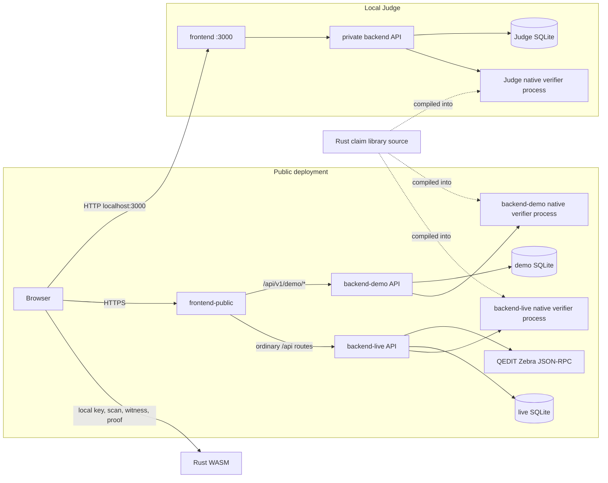

# Architecture

Horoi has the five MVP Next.js routes plus the authorized ZECATHON `/demo` walkthrough, a Bun/Hono API with SQLite, one canonical Rust claim library shared with browser WASM and the native verifier, and an optional QEDIT Zebra RPC connection for non-demo operation.

The three native verifier boxes are separate processes; the shared Rust claim library is reused at build time. Browser-local WASM proving remains in the holder's browser.

## Docker execution modes and trust boundaries

The default root `docker-compose.yml` is **DOCKER JUDGE DEMO**. Browser traffic reaches the Next.js production container on port 3000; Next.js proxies `/api` to `http://backend:8787` over an internal Compose network. The backend runs the native `horoi-verifier` and writes replay state to a project-scoped persistent SQLite volume. Only the frontend port is published to the host. This mode has no `.env`, RPC credentials, public-chain access, or snapshot scan at startup.

The Judge backend and public `backend-demo` load the exact pinned HCP1 fixture and the same Rust verifier. In demo mode, Rust derives the claim ID/domain and verifies the positive proof at startup. The local synthetic roots are pinned to the fixture and are not resolved against Zebra or QEDIT public testnet. The tamper and replay scenarios pass through the native verifier; the replay walkthrough uses the same migration and atomic unique-key SQLite operation as normal submission inside a request-local database that is closed afterward. Normal claims continue to use persistent SQLite. `/demo` fixture verification is distinct from browser-local WASM proof generation. Public `backend-live` does not load the fixture; its health endpoint reports API availability.

The standalone public Compose project `horoi-public` has separate live and demo backends. The live backend joins an internal network and egress network with its own database volume; the demo backend joins a separate internal network with no egress and its own project-scoped demo volume. The frontend joins both backend networks and the edge bridge, and is the only service published on VPS loopback port 3001. It proxies `/api/v1/demo/*` to the demo backend before sending other `/api/*` paths to the live backend. The local Judge frontend uses its own edge bridge while the Judge backend remains private. Public Compose trusts only the proxy-overwritten `X-Horoi-Client-IP`; arbitrary `X-Forwarded-For` is ignored. See [THREE_SURFACES.md](THREE_SURFACES.md) for admission limits and commands.

## Proof flow

The browser create form sends public name, description, ZIP 227 AssetId bytes, threshold, snapshot height, and optional expiry to the live backend's bounded claim-job route. It receives a job ID, polls status, and can explicitly cancel the job. The in-process job has a 14-minute deadline, uses the same canonical network/genesis, snapshot hash/root, reorg, claim-derivation, and SQLite insertion path as synchronous `POST /claims`, and reports the last completed scan range. It can resume complete 16-block ranges from a bounded, process-memory checkpoint only after confirming each current canonical end hash. The final snapshot hash/root and reorg checks still run before claim insertion. Job status and scan checkpoints are not persisted and are lost on backend restart; a restart does not move or substitute the snapshot.

A creator's request is validated before snapshot admission. The backend reads the Orchard commitment root and canonical public Orchard nullifiers from the selected chain history, derives the exclusion root, then stores immutable claim metadata including network identity and a random creator nonce.

A holder provides a test-only spending key in the claim page. The browser fetches public action ranges and public issuance fields. WASM reconstructs issuance notes, checks commitments, decrypts candidate outputs, computes commitment and exclusion witnesses, and creates a one-note proof locally. The browser submits the proof bundle and circuit-derived alternate nullifier through `POST /claims/:id/submit/jobs`, receives HTTP 202, and polls bounded in-memory job status while native verification and canonical snapshot validation run. Job status is lost on backend restart; the proof is not logged or persisted. The browser does not send the key, viewing key, decrypted notes, witness, exact balance, or queried holder nullifier.

The API loads the stored claim, passes the bundle to the native Rust verifier, checks the alternate nullifier against the circuit result, re-resolves both snapshot roots against the active chain, then atomically consumes the alternate nullifier under the claim ID. The same contributing note is rejected again within that claim domain. Different claim domains produce different alternate nullifiers under the implemented relation.

## Boundaries and limitations

Rust owns canonical encoding, AssetId and AssetBase handling, claim/domain derivation, circuit, proof serialization, and verification. TypeScript validates HTTP shapes and stores public metadata; it does not implement cryptographic rules. SQLite stores public claims and accepted alternate nullifiers, not proof bodies. The proof handles one normal note, with no split-note or four-note aggregation. The exclusion tree and alternate-nullifier design are experimental and unaudited. Local QEDIT Zebra regtest E2E passed; a real browser HCP1 proof was accepted on public QEDIT ZSA testnet at snapshot 7596 on 2026-10-25. See [PUBLIC_ZSA_E2E_REPORT.md](PUBLIC_ZSA_E2E_REPORT.md) for replay, verification, privacy, and measurement evidence.
