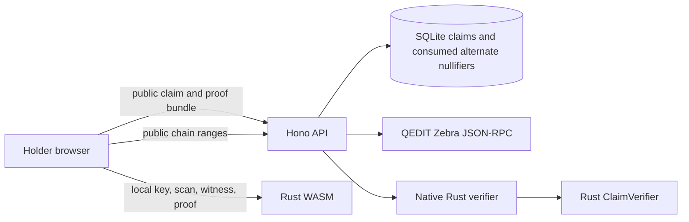

# Architecture

Horoi has five Next.js pages, a Bun/Hono API with SQLite, a Rust claim library shared with browser WASM, a native Rust verifier process, and a QEDIT Zebra RPC connection.

## Proof flow

A creator sends public name, description, ZIP 227 AssetId bytes, threshold, snapshot height, and optional expiry. The backend validates the AssetId, reads the Orchard commitment root and canonical public Orchard nullifiers from the selected chain history, derives the exclusion root, then stores immutable claim metadata including network identity and a random creator nonce.

A holder provides a test-only spending key in the claim page. The browser fetches public action ranges and public issuance fields. WASM reconstructs issuance notes, checks commitments, decrypts candidate outputs, computes commitment and exclusion witnesses, and creates a one-note proof locally. The browser submits the proof bundle and circuit-derived alternate nullifier. It does not send the key, viewing key, decrypted notes, witness, exact balance, or queried holder nullifier.

The API loads the stored claim, passes the bundle to the native Rust verifier, checks the alternate nullifier against the circuit result, re-resolves both snapshot roots against the active chain, then atomically consumes the alternate nullifier under the claim ID. The same contributing note is rejected again within that claim domain. Different claim domains produce different alternate nullifiers under the implemented relation.

## Boundaries and limitations

Rust owns canonical encoding, AssetId and AssetBase handling, claim/domain derivation, circuit, proof serialization, and verification. TypeScript validates HTTP shapes and stores public metadata; it does not implement cryptographic rules. SQLite stores public claims and accepted alternate nullifiers, not proof bodies. The proof handles one normal note, with no split-note or four-note aggregation. The exclusion tree and alternate-nullifier design are experimental and unaudited. Local QEDIT Zebra regtest E2E passed; a real browser HCP1 proof was accepted on public QEDIT ZSA testnet at snapshot 7596 on 2026-10-25. See [PUBLIC_ZSA_E2E_REPORT.md](PUBLIC_ZSA_E2E_REPORT.md) for replay, verification, privacy, and measurement evidence.
